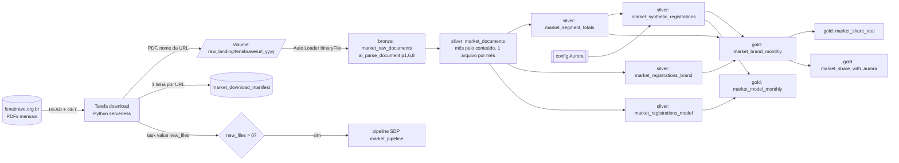

# ADR 001: Ingestão de mercado (Fenabrave) para a Tela 1 / Visão de Mercado

- **Status:** ACEITO (T4) e IMPLEMENTADO (T9, 2026-11-20; resultado na seção 7). Contratos da seção 4 **congelados**: qualquer mudança passa pelo tech lead.
- **Escopo:** somente dados. Download automático dos PDFs públicos mensais de emplacamentos da Fenabrave,
  parse para Delta (medalhão), linhas sintéticas da Aurora Motors **somadas** ao mercado real, orquestração
  como Lakeflow Job no bundle raiz. Fora do escopo: tela do app, redeploy do app, Lakebase, ML, Genie.
- **Evidência usada** (pasta da run `.team/runs/2026-11-20-mkt1/`): `reports/ingest.md` + `spike/` (T2),
  `reports/parser.md` + `spike-parser/` (T3), oráculo `pdftotext` do QA (`tests/market/oracle/`, branch
  `team/mkt1-qa` a220c6f), run de egress 438994186431458 (`spike/egress_result.txt`).
- **Quem decidiu:** a Leticia escolheu `ai_parse_document` (R3) e os parâmetros da Aurora (opção A, D4).
  As demais escolhas de julgamento abaixo foram **decididas com a opção recomendada pelo tech lead, que a
  Leticia pré-aprovou** (2026-11-20): 2004-01 (prévia) só com totais (D3); canonização de marca sem nomes
  literais (D2); agenda diária nos dias 1 a 15 com gate (D5); gold como materialized views (seção 4);
  linha residual `OUTRAS (NAO PUBLICADAS)` (D3).

## 1. Contexto e requisitos

| # | Requisito | Origem |
|---|---|---|
| R1 | Histórico completo desde 2003-01, mensal, por marca e modelo, segmentos **automóveis** e **comerciais leves** | brief da run |
| R2 | Download automático (sem passo manual) e idempotente: rodar de novo não baixa nem duplica nada | brief da run |
| R3 | Parser com `ai_parse_document` (decisão da Leticia) | brief da run |
| R4 | Medalhão bronze/silver/gold em `${catalog}.${schema}`, tabelas com prefixo `market_` | `tasks/todo.md` (Tela 0) |
| R5 | Aurora Motors (fictícia) somada **por cima** do mercado real, marcada com `is_synthetic` | `tasks/todo.md:9` |
| R6 | Lakeflow Job: tarefa de download → pipeline SDP, tudo no bundle raiz (`resources/*.yml`) | brief da run |
| R7 | Evidência em TEXTO em `evidence/market/` | `tasks/todo.md` (mapa FEBAR) |
| R8 | Nenhum nome de cliente real em arquivos commitados; marcas reais aparecem só como **dado** vindo do PDF | `tasks/lessons.md` |

## 2. Visão geral



## 3. Decisões

### D1. Download: tarefa Python no job, mês-agnóstica, gravando no Volume

- **Onde:** `src/market/download/`. A tarefa `spark_python_task` roda em compute serverless de job, com o
  código **sincronizado pelo bundle** (`python_file: ../src/market/download/<entry>.py`).
  *Evidência:* no spike de egress, `python_file` apontando para um Volume falhou duas vezes
  ("Cannot read the python file"), enquanto o mesmo script como arquivo do workspace rodou.
- **Egress: confirmado.** No run 438994186431458 (serverless), `2026_09_02.pdf` deu 200 (3.096.283 B)
  e `2026_10_02.pdf` deu 404. Por isso não há fallback de upload manual: o seed vem do próprio download.
- **O downloader baixa arquivos, não meses.** Cada PDF fica com o nome da própria URL em
  `/Volumes/${catalog}/${schema}/raw_landing/fenabrave/<url_yyyy>/<basename da URL>`, e o mês de referência
  é resolvido no pipeline, pelo conteúdo (D2). Motivo: a edição de março de 2023 só existe como
  `2023_02_3.pdf`, e todos os candidatos `*2023_03*` devolvem 404 (`spike/scan1.txt`; conteúdo confirmado
  pelo T3 e pelo QA).
- **Fontes de URL** (não existe página índice; padrão `https://www.fenabrave.org.br/portal/files/[P_]YYYY_MM_V.pdf`,
  com prefixo `P` em 2003–2015, `V=2` em 2015–2023 e `V=02` de 2024 em diante):
  1. **Histórico = semente versionada** `src/market/download/seed_urls.json`: as 277 URLs remotas que batem
     byte a byte com os PDFs locais (`spike/url_manifest_verified.json`; nos 23 meses com alias, fica o menor
     nome). São os mesmos arquivos do oráculo do QA.
  2. **Meses novos = descoberta:** para cada mês de URL depois do último da semente, até o mês corrente,
     fazer HEAD em **todos** os candidatos sem prefixo `YYYY_MM_02`, `YYYY_MM_2` e `YYYY_MM_3`, sem parar
     no primeiro hit. O GET só acontece quando o HEAD devolve 200 com `application/pdf`.
- **Validação:** status 200, `Content-Type: application/pdf` e bytes iniciando com `%PDF`. Nunca decidir
  pelo tamanho: a página 404 do IIS tem de 5.191 a 5.197 B. Um 404 nunca vira arquivo.
- **Deduplicação:** `sha256` do conteúdo. Um hash já gravado vira `status='duplicate'`, com `duplicate_of`.
- **Idempotência:** 1 linha por **URL candidata** no manifesto. Status terminais (`downloaded`, `duplicate`,
  `not_found`) não são retestados, exceto os `not_found` dos **3 meses de URL mais recentes** (publicação
  atrasada: 2026-10 ainda estava em 404 no dia 2026-11-20). Arquivo existente **nunca é sobrescrito**.
  A escrita atômica usa `raw_landing/_tmp_fenabrave/` (**fora** do caminho do Auto Loader) e depois move.
- **Resiliência e cortesia:** timeout de 30 s, 3 tentativas com backoff exponencial, no máximo 4 requisições
  em paralelo, pausa de 0,2 s e User-Agent genérico. No T2, cerca de 4.400 requisições com 6 em paralelo
  não deram nenhum 429/403/5xx. A tarefa do job tem `max_retries: 2` e `min_retry_interval_millis: 60000`.
- **Saída:** a tarefa grava o manifesto com `MERGE` por `source_url` e publica
  `dbutils.jobs.taskValues.set("new_files", <n>)`.
- **Backfill:** o primeiro run baixa as 277 URLs da semente (cerca de 1,5 GB) e faz HEAD dos meses
  posteriores a 2026-01.

Alternativas rejeitadas:
- *Download dentro do pipeline SDP:* mistura I/O externo com a semântica declarativa e re-executa em full refresh.
- *Varrer `P × V` a cada run* (cerca de 4.070 HEADs) ou baixar todas as revisões de 2003–2015: custa mais e
  não há critério para escolher a revisão "certa". A semente verificada fixa o histórico.
- *Manifesto com chave por mês:* o downloader teria de adivinhar o mês pelo nome do arquivo.
- *`http_request` em SQL:* depende de UC connection e não grava binário no Volume.

### D2. Parsing: `ai_parse_document` na bronze (uma vez por arquivo), regras na silver

**Bronze `market_raw_documents`**: *streaming table* em **SQL**:

```sql
-- forma de referência; a implementação final é do T6
CREATE OR REFRESH STREAMING TABLE market_raw_documents
TBLPROPERTIES ('pipelines.reset.allowed' = 'false')
AS SELECT
  path AS source_path,
  regexp_extract(path, '[^/]+$', 0) AS file_name,
  length AS file_size,
  modificationTime AS file_modification_time,
  ai_parse_document(content, map('version','2.0','descriptionElementTypes','','pageRange','1,6,8')) AS parsed,
  current_timestamp() AS _ingested_at
FROM STREAM read_files('${market.landing_path}', format => 'binaryFile',
                       pathGlobFilter => '*.pdf', allowOverwrites => 'false');
```

- **Uma vez por arquivo:** o streaming garante isso, e `pipelines.reset.allowed=false` impede que um full
  refresh acidental parseie tudo de novo. Também por isso o determinismo do parser entre execuções
  (não testado no T3) não afeta a idempotência: cada PDF é parseado uma única vez.
- **`pageRange '1,6,8'`** (T3, achado 6): p1 traz os totais e o mês, p6 o ranking **mensal** de modelos e p8
  o ranking **mensal** de marcas. A varredura de 277 PDFs pôs o ranking de modelos na p6 e o de marcas na p8
  em todos os 268 com camada de texto. Dos 9 restantes, o T3 parseou 7, e eles têm o mesmo layout, exceto
  2004-01. O `page_id` continua com a numeração original e **0-based** (p6 = `page_id 5`). O tempo cai de
  50–71 s para 23–27 s por PDF. Sem descrições de IA (`descriptionElementTypes ''`), por custo.
- `parsed:error_status` não nulo **não** é descartado na bronze: a silver marca o documento como
  `parse_status='error'`, e ele aparece na cobertura.

**Silver `market_documents`** (materialized view, Python): 1 linha por arquivo. Resolve `ref_month`,
`parse_dialect` e `is_selected`.
- **Mês de referência:** preferir o cabeçalho de coluna da p6 `Mmm/AA` (presente em todas as eras); conferir
  com o cabeçalho da p1 (`2023 Mar (A)`, `2024<br>Fev<br>(A)`, `JAN (A)`) e com o título
  `Resumo Mensal <Mês> de <Ano>` (ausente em 2024-05). Os meses são abreviados em português (`Fev`, `Abr`,
  `Mai`, `Ago`, `Set`, `Out`, `Dez`), maiúsculos ou não, e usam um **mapa explícito** (o `to_date` não
  entende português). A linha "São Paulo, <Mês> de <Ano>" é a data de **publicação** e nunca serve como mês.
  O nome do arquivo **não** é fonte do mês.
- **Um arquivo por mês:** se dois arquivos distintos resolverem para o mesmo `ref_month`, vence o de maior
  `file_modification_time` (o último a chegar no Volume, isto é, a revisão mais nova), com `source_path`
  como desempate. O outro recebe `is_selected=false`, e uma expectation `warn` (`one_file_per_month`)
  registra o caso.
- **O pipeline não lê o manifesto do job** (falha no update de validação de 2026-11-20, pipeline
  `3ee6d2a9`: `spark.catalog.tableExists` não é permitido dentro de uma função de dataset no SDP
  serverless, `Py4JSecurityException`). *Decidido (recomendado, pré-aprovado):* remover essa dependência.
  Ler o manifesto sem a checagem também falharia, sempre que o pipeline fosse validado antes do primeiro
  download, e acoplaria os dois componentes. Regra geral: **nenhuma chamada a `spark.catalog` nem ação
  Spark dentro de funções de dataset**. Por compatibilidade, a coluna `market_documents.source_last_modified`
  continua no contrato e agora recebe `file_modification_time`.
- `parse_dialect`: `A_modelo` (2003–2014), `B_upper` (2015), `C_fabricante` (2016+), `D_2024` (2024+, cabeçalho
  com `<br>`) e `previa` (2004-01; valor em ASCII). É informativo; as regras de extração abaixo valem para todos.

**Extração** (uma função Python pura, `parse_tables(elements) -> rows`, com testes unitários sobre o JSON do
spike; HTML via stdlib `html.parser`, sem regex de `<tr>`):
- **Seleção por página e ordem, não por cabeçalho** (`<th>Modelo</th>` também aparece nos rankings acumulados,
  em eletrificados e em caminhões e motos): `page_id 5` traz as tabelas na ordem 1ª = automóveis e
  2ª = comerciais leves; em `page_id 7`, 1ª = automóveis, 2ª = comerciais leves e 3ª = Autos+CL, que é
  **ignorada**. Os totais vêm da 1ª tabela de `page_id 0` cujo primeiro cabeçalho começa com `Segment`, nas
  linhas `^[aA]\)` (Autos) e `^[bB]\)` (Com. Leves). O título da página serve só de checagem: a partir de
  2024 o rótulo do segmento vem num elemento `figure`.
- **Correção do T6:** em 2003, a p8 vem na ordem Autos, Autos+CL, CL. Por isso a ordem é só o último recurso.
  *Decidido (recomendado, pré-aprovado):* o segmento de cada tabela de ranking é escolhido em três passos:
  1. o rótulo acima da tabela, casado por **tokens** (`AUTO`, `COM`/`COMERCIAIS`, `LEVES`), não por igualdade
     exata; um rótulo com os dois segmentos marca a tabela mista;
  2. se o rótulo faltar, a **soma listada** comparada com os totais da p1: a tabela de comerciais leves tem
     soma ≤ total de CL, e a mista tem soma > total de Autos;
  3. só então a ordem.
  Uma tabela de CL cuja soma passe do total de CL da p1 nunca é aceita.
- **Coluna do mês** escolhida pelo cabeçalho que bate com `ref_month`
  (`^(Jan|Fev|Mar|Abr|Mai|Jun|Jul|Ago|Set|Out|Nov|Dez)/\d{2}$`, sem diferenciar maiúsculas e **sem acentos**:
  o cabeçalho é normalizado antes do match), nunca pela posição. Correção do T9: o OCR gerou `Maí/16` num dos
  cabeçalhos da p6 de edições de maio (2016, 2017, 2018 e 2020), e a tabela era rejeitada.
- **Normalização das células:** remover tags (`<mark>`, `<br>`); descartar uma 1ª célula vazia e linhas
  vazias; remover o rank colado no início (`^\d+\s?[º°]\s*`, com os dois glifos), guardando-o como `rank`;
  números pt-BR → `INT` removendo `.` e também `,` (vírgula de OCR em 2015-01: `13,632`).
- **Tabela de marcas: a célula inteira é a marca.** Ela **nunca** é separada em `/`. Correção do T9
  (QA, verificada com `pdftotext` na p8 de 2022-04): existem fabricantes publicados com `/` no nome, como
  `MARCA_A/MARCA_B` no rank 12, distinto de `MARCA_A` no rank 13. Separar na `/` fundia os dois e criava
  buracos no ranking (34 meses de CL, de 2020-09 a 2023-06). Fazer `trim`, colapsar espaços e passar para
  maiúsculas sem acento. A troca de nome do fabricante a partir de 2023-07 (o mesmo fabricante passa a ser
  publicado sem `/`) **não** é unificada: seria preciso um alias literal no código (R8). Fica como limitação
  conhecida da série.
- **Tabela de modelos: marca = o prefixo mais longo que existe na tabela de marcas do mesmo mês e segmento.**
  Exemplo genérico: em `MARCA_A/MARCA_B/MODELO_X`, se `MARCA_A/MARCA_B` for marca publicada no mês, a marca
  é `MARCA_A/MARCA_B` e o modelo é `MODELO_X`. Sem nenhum prefixo publicado, ou num mês sem tabela de marcas,
  separar na **primeira** `/`; assim, `MARCA/MODELO/VERSAO` dá o modelo `MODELO/VERSAO`.
- **Canonização da marca sem nomes literais no código (R8):** depois disso, a marca de cada linha de modelo
  é casada com as marcas da tabela de marcas **do mesmo mês e segmento**: igualdade e, se não houver, prefixo
  único, por exemplo um erro de OCR que corta a última letra do nome. Sem match, a marca fica como veio e
  entra no relatório de qualidade do T8.
  *Rejeitado:* uma tabela de aliases com nomes de marcas no código. Ela poria nomes reais em arquivos
  commitados e só corrigiria 4 de cerca de 1.290 linhas (T3, achado 1).
- **Revisões:** cada mês usa os números do **próprio** PDF. As colunas de mês anterior e de acumulado são
  ignoradas (o oráculo do QA mostra 233 de 536 revisões, quase todas ≤ 20 unidades).
- **PDFs sem camada de texto utilizável** (5: 2020-04, 2020-05, 2020-06, 2023-09, 2024-01): o
  `ai_parse_document` faz OCR, e o T3 validou a coerência interna. O guard é a reconciliação (D3), que o T8
  faz contra os valores lidos à mão em `pdf_totals_visual_override.csv`, só como relatório. Em 2024-05
  só o título está corrompido; os dígitos estão certos e batem com o oráculo, então a reconciliação é exata.
- **Rótulos dos totais na p1:** `a) Autos`, `A) Autos` e `a) Autos¹` (prévia, 2012-09, 2015-01/02), além
  de `(a + b)`. A regra `^[aA]\)` / `^[bB]\)` cobre todos.

Alternativas rejeitadas: *pdfplumber* (fora de R3; e o `ai_parse_document` faz OCR nos PDFs só com imagem,
o que o pdfplumber não faz); *MV na bronze* (recomputaria e cobraria todos os parses); *parse do documento
inteiro* (2,5× mais lento, sem ganho para o escopo).

### D3. Cobertura, residual e qualidade

- **Nenhum ranking é censo** (T3, achado 8; oráculo do QA): modelos = top 50 (automóveis com 89,3% a 99,2% do
  total da p1; comerciais leves ≥ 99,9%); marcas = top 20/21 (automóveis ≥ 99,1%; comerciais leves ≥ 99,3%).
  Não existe linha "Outros".
- **Denominador** de todo share = total publicado na p1 (`market_segment_totals`), nunca `sum(rows)`.
- **Linha residual** na gold de marcas: `brand='OUTRAS (NAO PUBLICADAS)'`, `is_residual=true`,
  `units = total − soma das marcas publicadas`, `rank` nulo, nunca `is_synthetic`. Com isso, a gold de
  marcas soma **exatamente** o total publicado.
- **Faixas (T8 valida, o pipeline alerta):** `0 ≤ residual ≤ 3%` do total do segmento (pior caso conhecido:
  2,07%). Se a soma listada passar do total, a expectation `warn` dispara e o residual é truncado em 0.
  Modelos: só relatório, sem faixa.
- **Expectations que param o update** (`FAIL UPDATE`): `segment IN ('automoveis','comerciais_leves')` e
  `units >= 0`. **Expectations de alerta** (`warn`): `month_resolved` (documento sem `ref_month`),
  `one_file_per_month`, sequência de rank sem buracos (empates permitidos), `residual_in_range` (exceto os
  meses de `known_no_brand_table_months`) e `brand_matched`.
- **Documento sem mês não para o pipeline** (revisão do T6). *Decidido (recomendado, pré-aprovado):* um PDF
  com `ref_month` nulo ou erro de parse fica com `is_selected=false` e `parse_status` de `error` ou
  `no_month`, e dispara o alerta `month_resolved`. Motivo: a bronze nunca reparseia um arquivo
  (`pipelines.reset.allowed=false`), então um `FAIL` aqui travaria **todos** os updates seguintes até
  alguém apagar o PDF à mão. A falha continua visível de duas formas: o mês some de
  `market_segment_totals` e a checagem de cobertura do T9 reprova, porque `known_missing_months` é vazio.
- **Janela de cobertura (T9):** meses esperados = 2003-01 até o maior `ref_month` em `market_segment_totals`.
  Uma lacuna só é aceita se estiver na lista versionada `market.known_missing_months` (configuração do
  pipeline). Valor congelado: **vazio**. 2012-09 e 2020-06 não foram parseados no T3; se falharem no
  backfill, só entram na lista com evidência e aprovação do tech lead.
- **2004-01 (edição "prévia", 6 páginas)**, correção C14 do QA, verificada com `pdftotext`: a p1 **tem**
  os totais (`a) Autos¹ 87.489`, `b) Com. Leves¹ 13.620`, `(a + b) 101.109`, que batem com o oráculo).
  A p5 traz o ranking de modelos de automóveis e a p6 o de comerciais leves, sem coluna de mês
  `Mmm/AA`. Não há tabela de marcas com unidades: a p2 só tem percentuais. *Decidido (recomendado,
  pré-aprovado pela Leticia):* o mês **entra** em `market_segment_totals`, com
  `brand_table_found=false` e `model_table_found=false`. Não se cria um dialeto só para uma edição.
  Regra geral que cobre o caso: as tabelas de modelos da p6 só são aceitas quando o cabeçalho de mês da
  p6 bate com o `ref_month`; sem isso, `model_table_found=false`. Assim, a tabela de comerciais leves da
  p6 da prévia nunca é rotulada como automóveis.
- **Mês sem tabela de marcas:** `market_segment_totals.brand_table_found=false` só é aceito para meses em
  `market.known_no_brand_table_months`. Valor congelado: **`2004-01`** (ver acima). O T3 mostrou que 2022-01
  **tem** ranking de marcas (21+21+21 linhas), o que corrige o rascunho anterior deste ADR. Num mês listado,
  o residual carrega 100% do total.
- **Mês sem tabela de modelos:** `model_table_found=false` só é aceito para meses em
  `market.known_no_model_table_months`. Valor congelado: **`2004-01`**: a prévia não tem coluna de mês na
  p6 (regra do QA, 37fb5d6). A expectation de alerta `model_table_found_or_known` fica em
  `market_segment_totals`, e o T8 reprova fora da lista.

### D4. Aurora Motors sintética: soma por cima do mercado real

- **Sem ações Spark na definição** (revisão do T7): a MV não pode chamar `.collect()` nem
  `createDataFrame` sobre dados lidos do pipeline (skill `databricks-pipelines`,
  `references/python-basics.md:35-36`). A curva de share e os pesos por mês e modelo são calculados em
  Python puro, numa tabela pequena e estática, e o volume vem de expressões Spark num join *lazy* com
  `market_segment_totals`.
- Gerada **dentro do pipeline** por uma materialized view Python determinística (`src/market/synthetic/`),
  a partir de uma config versionada (`aurora_config`) com lançamento, modelos, segmento, curva de share,
  sazonalidade e `seed`.
- **Parâmetros (decisão da Leticia, opção A):** lançamento em 2019-01; só **automóveis**; modelos `IPE` (hatch),
  `JATOBA` (SUV compacto) e `AROEIRA` (sedã); share sobe até ~3% em 2022 e fica entre 3% e 4% depois, com
  sazonalidade leve; `seed` fixo.
- **Volume:** `aurora_units = round(share × total_real / (1 − share))`, com `total_real` = total publicado de
  automóveis do mês (`market_segment_totals`). Por construção, `aurora / (total_real + aurora) = share`.
  A divisão entre os 3 modelos vem da config, com ruído do `seed`.
- **Regras:** `brand='AURORA MOTORS'` e `is_synthetic=true` em todas as linhas; nenhuma linha real tem
  `is_synthetic=true`; o total real nunca é alterado. Faixa de share (sobre o total com Aurora): `[0%, 4%]` em
  2019–2021 e `[3%, 4%]` de 2022 em diante; o gerador limita o share a essa faixa. A Aurora só existe para
  meses presentes em `market_segment_totals` a partir de 2019-01.
- Mesma config + seed → mesmas linhas (rerun idempotente).

Alternativas rejeitadas: *tirar share das marcas reais* (adultera o dado público); *CSV sintético no Volume*
(artefato manual, perde lineage).

### D5. Orquestração: Lakeflow Job no bundle raiz

- `resources/market_pipeline.yml` (dono: parser): pipeline SDP `market_pipeline`, `serverless: true`,
  `catalog: ${var.catalog}`, `schema: ${var.schema}` (não `target`), `root_path` + `libraries.glob` para
  `src/market/pipeline/**` e `src/market/synthetic/**`. `configuration` com:
  - `market.landing_path` = `/Volumes/${var.catalog}/${var.schema}/raw_landing/fenabrave/`;
  - `market.known_missing_months` = vazio;
  - `market.known_no_brand_table_months` = `2004-01`;
  - `market.known_no_model_table_months` = `2004-01`.
- `resources/market_job.yml` (dono: ingest): job `market_monthly` com três tarefas:
  1. `download`: `spark_python_task` com `environment_key` (cliente serverless `"1"`, **sem dependências**:
     o HTTP usa `urllib` da stdlib; *decidido (recomendado, pré-aprovado)* pelo T5, porque elimina a
     instalação de pacote no serverless), `max_retries: 2`;
  2. `has_new_files`: `condition_task` com `{{tasks.download.values.new_files}} GREATER_THAN 0`;
  3. `pipeline`: `pipeline_task` com `${resources.pipelines.market_pipeline.id}` e `full_refresh: false`,
     `depends_on has_new_files outcome "true"`.
  Parâmetros do job: `catalog` e `schema` (vindos das variáveis do bundle), passados à tarefa de download.
- **Agenda:** a publicação sai entre os dias 1 e 8 do mês seguinte, com atrasos de até o dia 13 (T2). Por isso,
  `quartz_cron_expression: "0 0 7 1-15 * ?"` e `timezone_id: America/Sao_Paulo`. **Entregue com
  `pause_status: PAUSED` em todos os targets** (restrição do lead enquanto a Leticia está ausente). Os runs
  são disparados manualmente com `bundle run market_monthly`. **Follow-up da Leticia:** despausar no target
  `demo` quando quiser a atualização automática (mudar para `UNPAUSED` em `resources/market_job.yml` e fazer
  `bundle deploy`). *Rejeitados:* um dia fixo (perde meses atrasados) e o trigger de file arrival
  (nada chega sem o próprio downloader rodar).
- **Deploy (lead):** `databricks bundle validate --strict -t demo` → `databricks bundle deploy -t demo` →
  `databricks bundle run market_monthly -t demo`, sempre com `--profile classic-stable-new`. **Não** usar
  `deploy.sh` nem `bundle run app`. `bundle deploy` sozinho não cria deployment de app (fato da run fnd0).

### D6. Plano de evidência (texto, `evidence/market/`, dono: QA)

**Sem nomes de marcas reais na evidência commitada (R8).** *Decidido (recomendado, pré-aprovado; pergunta
do QA no T9):* nos arquivos de evidência, toda marca real é trocada por um token estável
`BRAND_<6 primeiros hex do sha256 do nome>`. Contagens, meses, ranks, unidades e shares ficam intactos, e a
reconciliação continua exata. `AURORA MOTORS` (fictícia) e `OUTRAS (NAO PUBLICADAS)` não são mascaradas.
*Rejeitado:* commitar os nomes porque o dado é público. O repositório vai ser público, e a regra do projeto
proíbe nomes reais em arquivos commitados. As marcas continuam visíveis **como dado** nas tabelas do workspace.

| Arquivo | Conteúdo |
|---|---|
| `download-run.txt` | saída da tarefa de download e `new_files` |
| `manifest.txt` | `status × origin` e meses de URL sem arquivo |
| `pipeline-run.txt` | estado do update, linhas por tabela, resultado das expectations |
| `coverage.txt` | meses esperados × presentes, lacunas × `known_missing_months` |
| `reconciliation.md` | `market_segment_totals` × oráculo (exato); gold de marcas = total (exato); cobertura dos rankings |
| `synthetic-isolation.txt` | contagens por `is_synthetic` e totais real × com Aurora |
| `idempotency.txt` | 2º run: 0 downloads, condição `false` com o pipeline pulado, snapshots iguais |

## 4. Contratos congelados

Tipos Spark SQL. PK = chave lógica, que o T8 verifica como única. Todas as tabelas silver e gold são
**materialized views**; a bronze é **streaming table**; o manifesto é uma tabela Delta comum, gravada pelo job.
`segment ∈ {'automoveis','comerciais_leves'}`. `share` é **fração** (0,03 = 3%).

**`market_download_manifest`** (job; PK `source_url`)
`source_url STRING, url_month DATE, file_path STRING, bytes BIGINT, sha256 STRING, status STRING
('downloaded'|'duplicate'|'not_found'|'failed'), duplicate_of STRING, http_status INT, origin STRING
('seed'|'discovery'), source_last_modified TIMESTAMP, attempted_at TIMESTAMP, downloaded_at TIMESTAMP`

**`market_raw_documents`** (bronze ST; PK `source_path`)
`source_path STRING, file_name STRING, file_size BIGINT, file_modification_time TIMESTAMP, parsed VARIANT,
_ingested_at TIMESTAMP`

**Tabelas internas de apoio** (silver, materialized views **publicadas**, fora do contrato de consumo; podem
mudar sem aviso): `market_parsed_documents` (saída do parser por PDF, em arrays), `market_rank_checks` e
`market_brand_residual`. *Decidido (recomendado, pré-aprovado), update `d2028843` de 2026-11-20:* elas eram
MVs **privadas**. A privada `market_parsed_documents` registrou 285 linhas de saída, mas todas as MVs que a
liam ficaram com 0 linhas, e a tabela privada não pode ser consultada para investigar. Publicar as três
elimina essa variável e torna a cadeia observável. Nenhum consumidor (app, Genie) deve lê-las.

**`market_documents`** (silver; PK `source_path`)
`source_path STRING, file_name STRING, ref_month DATE, month_source STRING ('p6_header'|'p1_header'|'title'),
parse_dialect STRING, parse_status STRING ('ok'|'error'|'no_month'), is_selected BOOLEAN,
source_last_modified TIMESTAMP (= `file_modification_time` do Volume), _ingested_at TIMESTAMP`

**`market_segment_totals`** (silver; PK `ref_month, segment`)
`ref_month DATE, segment STRING, units INT, brand_table_found BOOLEAN, model_table_found BOOLEAN,
source_file STRING, parse_dialect STRING`

**`market_registrations_brand`** (silver, real, top 20/21; PK `ref_month, segment, brand`)
`ref_month DATE, segment STRING, brand STRING, units INT, rank INT, source_file STRING, page_id INT,
parse_dialect STRING`

**`market_registrations_model`** (silver, real, top 50; PK `ref_month, segment, brand, model`; duplicatas
agregadas: `sum(units)`, `min(rank)`)
`ref_month DATE, segment STRING, brand STRING, brand_raw STRING, brand_matched BOOLEAN, model STRING,
units INT, rank INT, source_file STRING, page_id INT, parse_dialect STRING`

**`market_synthetic_registrations`** (silver; PK `ref_month, segment, brand, model`)
`ref_month DATE, segment STRING, brand STRING, model STRING, units INT, target_share DOUBLE,
is_synthetic BOOLEAN, generator_version STRING, seed INT`

**`market_brand_monthly`** (gold; PK `ref_month, segment, brand`): linhas reais + residual + Aurora
`ref_month DATE, segment STRING, brand STRING, units INT, rank INT (posição publicada; nulo para residual e
Aurora), is_synthetic BOOLEAN, is_residual BOOLEAN`

**`market_model_monthly`** (gold; PK `ref_month, segment, brand, model`): top 50 real + modelos Aurora
`ref_month DATE, segment STRING, brand STRING, model STRING, units INT, rank INT (publicado; nulo para Aurora),
is_synthetic BOOLEAN`

**`market_share_real`** e **`market_share_with_aurora`** (gold; PK `ref_month, segment, brand`), mesmas colunas:
`ref_month DATE, segment STRING, brand STRING, units INT, segment_total_units INT, share DOUBLE, rank INT,
is_synthetic BOOLEAN, is_residual BOOLEAN`
- `market_share_real`: sem linhas sintéticas; `segment_total_units` = `market_segment_totals.units`.
- `market_share_with_aurora`: tudo; `segment_total_units` = total publicado + Aurora do segmento.
- `rank` = `dense_rank()` por `units` desc **entre as linhas não residuais** (a Aurora entra no ranking da
  view com Aurora); nulo para o residual. O residual aparece nas duas views.
- Materialized views, e não views de SQL, para evitar dependência de recurso do SDP não validado no spike.

## 5. Atribuições (T5–T8, todas liberadas agora, em paralelo)

| Task | Dono | Entrega | Escopo exclusivo |
|---|---|---|---|
| T5 | mkt1-ingest | download (D1) + `market_job.yml` (D5) + testes | `src/market/download/**`, `resources/market_job.yml`, `tests/unit/download/**` |
| T6 | mkt1-parser | pipeline bronze/silver/gold (D2, D3, seção 4) + `market_pipeline.yml` + testes de `parse_tables` | `src/market/pipeline/**`, `resources/market_pipeline.yml`, `tests/unit/pipeline/**` |
| T7 | mkt1-ingest | gerador Aurora (D4) como fonte do pipeline | `src/market/synthetic/**`, `tests/unit/synthetic/**` |
| T8 | mkt1-qa | suíte de validação + script de evidência (D3, D6, seção 4) | `tests/market/**`, `evidence/market/**` |

Interfaces entre donos: o glob do pipeline (T6) inclui `src/market/synthetic/**` (T7), e o T7 lê só
`market_segment_totals`. O job (T5) referencia `${resources.pipelines.market_pipeline.id}` (T6). Os nomes
são os da seção 4. Antes do deploy, `databricks bundle validate --strict -t demo` precisa passar com os
quatro branches juntos (revisão do tech lead).

## 6. Riscos remanescentes

1. Erro de dígito no OCR dos 5 PDFs sem texto: o único oráculo é a leitura manual dos totais da p1 feita pelo QA. A mitigação é a faixa do residual e o
   relatório do T8.
2. Uma edição futura que mude as páginas 6 e 8 quebraria o `pageRange`. A mitigação é o alerta
   `month_resolved`, a reprovação da cobertura no T9 e as flags `model_table_found` / `brand_table_found`
   falsas fora da lista; nesse caso, o ADR é revisto.
3. Custo do `ai_parse_document` no backfill (285 PDFs × 3 páginas, cerca de 25 min na bronze) ainda não está
   medido: a consulta a `system.billing.usage` voltou vazia no mesmo dia (a tabela é atualizada com atraso).
   Conferir depois pelo `pipeline_id` `3ee6d2a9-398c-4b85-87d6-b313809c81f5`.
4. ~~Auto Loader sobre Volume gerenciado dentro do pipeline~~: **funcionou** no primeiro update real
   (285 arquivos na bronze).

## 7. Resultado da implementação (2026-11-20)

Em produção no target `demo`: job `market_monthly` (289664164561831) e pipeline `market_pipeline_demo`
(`3ee6d2a9-398c-4b85-87d6-b313809c81f5`). A evidência completa está em `evidence/market/` (índice em
`README.md`).

- **Dados:** 285 PDFs, todos os meses de 2003-01 a 2026-09, sem lacunas. A reconciliação com o oráculo do QA é
  **exata**: 570 de 570 combinações mês × segmento, incluindo os 5 meses só com imagem. A gold de marcas soma
  exatamente o total publicado. A suíte final teve 14 de 14 checagens aprovadas.
- **Idempotência:** o 2º run do job não baixou nada e pulou o pipeline (`has_new_files=false`). Dois updates
  seguidos do pipeline sem mudança deram contagens e fingerprints `xxhash64` idênticos em todas as tabelas,
  e a bronze ficou intacta (sem novas versões).
- **O que deu errado no caminho** (cada item virou regra neste ADR):
  1. `spark.catalog.tableExists` dentro de uma função de dataset é proibido no SDP serverless
     (`Py4JSecurityException`). O pipeline deixou de ler o manifesto (D2).
  2. Uma UDF Python definida num arquivo-fonte do pipeline é serializada por referência a um módulo do
     runtime (`dbruntime`) que não existe nos executores. A UDF agora é construída a partir de um módulo
     registrado com `register_pickle_by_value`.
  3. MVs privadas: os leitores da MV privada `market_parsed_documents` receberam 0 linhas, mesmo com 285
     linhas de saída nela. As MVs de apoio foram publicadas (seção 4).
  4. Marcas com `/` no nome eram separadas (D2), e o OCR gerou `Maí` em cabeçalhos de maio (D2).
  Os PDFs foram parseados **uma única vez**: nenhuma correção exigiu full refresh.

### Follow-ups (decisões da Leticia ou melhorias)

| # | Item | Recomendação |
|---|---|---|
| F1 | A agenda do job está `PAUSED` (restrição enquanto a Leticia estava ausente) | Despausar no `demo` quando quiser atualização automática |
| F2 | Mudança do nome publicado de um fabricante em 2023-07 (a série se divide em dois nomes) | Manter assim, documentado em `docs/data-model/market.md`. Unificar exigiria nome real no código (R8) |
| F3 | 615 linhas de modelo com `brand_matched=false` (marca fora do top 20 do mês ou grafia diferente) | Só informativo; avaliar se a Tela 1 usa ranking de modelos por marca |
| F4 | Espaços em volta da `/` nos nomes não são normalizados | Ajuste pequeno no `norm()` do parser, com teste |
| F5 | Custo do backfill | Medir em `system.billing.usage` (risco 3) |
| F6 | Os commits antigos deste ADR têm 2 exemplos com nomes reais de marca e modelo | Já previsto: publicar o repositório com histórico novo (`tasks/todo.md`) |
