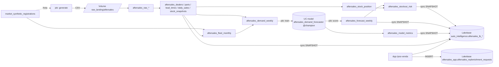

# Modelo de dados: pós-venda (Tela 2 / Ruptura de peças)

Catálogo e schema: `${catalog}.${schema}` (target `demo` = `classic_stable.auto_intelligence`). Todas as tabelas
têm o prefixo `aftersales_`. As decisões e as alternativas rejeitadas estão no ADR
[`docs/architecture/aftersales.md`](../architecture/aftersales.md). Este documento é o **contrato congelado**
(v1, 2026-11-20). Qualquer mudança de nome, tipo ou PK passa pelo tech lead. Colunas novas (aditivas) podem
entrar, desde que sejam avisadas.

> **Tudo aqui é 100% sintético.** As concessionárias, as peças, os preços, as vendas e o estoque são fictícios.
> A única entrada externa é a frota da Aurora Motors, que também é fictícia e vem de
> `market_synthetic_registrations` (Tela 1). Nenhum dado das CSVs da demo antiga é usado.

## 1. Linhagem

## 2. Convenções

- IDs: `dealer_id` = `D001`..`D012`, `part_id` = `P001`..`P060`, `category_id` = slug em inglês (`brakes`,
  `filters`, `suspension`, `electrical`, `engine`, `cooling`, `lighting`, `air_conditioning`).
  `category_name` é o nome em pt-BR (`Freios`, `Filtros`, ...).
- Semana = segunda a domingo, identificada por `week_start` (DATE, segunda-feira).
- Quantidades usam o sufixo `_units`. Na camada raw e na silver são `INT`. Previsões, e tudo o que deriva
  delas, são `DOUBLE`, exceto `recommended_qty`, que é `INT`.
- Dinheiro: `DOUBLE` em reais, com o sufixo `_brl`. O app arredonda só na exibição.
- Calendário (D2 do ADR): vendas diárias de 2019-01-01 a **2026-11-15**. `forecast_date` = **2026-11-16**
  (primeira semana prevista). Corte do backtest = **2026-08-16**. Holdout = 13 semanas, de 2026-08-17 a 2026-11-15.
- Todas as tabelas têm `COMMENT`. As tabelas silver, gold e ML têm `COMMENT` também em cada coluna, e todas
  levam as tags de UC `synthetic=true`, `aid_domain=aftersales` e `layer=<raw|silver|gold|ml>` (D9).

## 3. Arquivos de entrada (Volume `raw_landing/aftersales/`)

CSV com cabeçalho, UTF-8, vírgula, datas ISO e ponto decimal. O gerador **sobrescreve** os arquivos, com nomes
fixos e saída deterministicamente igual byte a byte para o mesmo `seed` e a mesma `generator_version`.

| Arquivo | Colunas |
|---|---|
| `dealers/dealers.csv` | `dealer_id, dealer_name, city, state, region, opened_on, fleet_share` |
| `parts/parts.csv` | `part_id, part_name, category_id, category_name, unit_price_brl, unit_cost_brl, is_critical` |
| `lead_times/lead_times.csv` | `dealer_id, part_id, lead_time_days` |
| `daily_sales/daily_sales_YYYY-MM.csv` | `sale_date, dealer_id, part_id, demand_units, sold_units, lost_units` |
| `stock_snapshots/stock_snapshots_YYYY-MM.csv` | `snapshot_date, dealer_id, part_id, on_hand_units, on_order_units` (semanal, aos domingos) |
| `_manifest/manifest.json` | `generator_version, seed, history_start, history_end, row_counts{entidade: n}` |

## 4. Tabelas (PK = chave lógica única e sem nulos; o QA verifica)

### Raw: streaming tables (`layer=raw`)
`aftersales_raw_dealers`, `aftersales_raw_parts`, `aftersales_raw_lead_times`, `aftersales_raw_daily_sales`
e `aftersales_raw_stock_snapshots`. Cada uma tem as colunas do CSV como `STRING`, mais
`_source_file STRING` e `_ingested_at TIMESTAMP`. Ficam fora do contrato de consumo.

### Silver: materialized views (`layer=silver`)

**`aftersales_dealers`** (PK `dealer_id`)
`dealer_id STRING, dealer_name STRING, city STRING, state STRING (UF), region STRING ('Sudeste'|'Sul'|'Nordeste'|'Centro-Oeste'), opened_on DATE, fleet_share DOUBLE`
- 12 lojas, pelo menos 2 por região. `Σ fleet_share = 1` (tolerância 1e-9). Os nomes são fictícios, no formato
  "Aurora Motors <Cidade>".

**`aftersales_parts`** (PK `part_id`)
`part_id STRING, part_name STRING (pt-BR genérico), category_id STRING, category_name STRING, unit_price_brl DOUBLE, unit_cost_brl DOUBLE, is_critical BOOLEAN`
- 60 peças, sem código nem marca reais. Regra: `0 < unit_cost_brl < unit_price_brl`.

**`aftersales_lead_times`** (PK `dealer_id, part_id`)
`dealer_id STRING, part_id STRING, lead_time_days INT` (entre 3 e 30). Existem as 12 × 60 = 720 linhas.

**`aftersales_daily_sales`** (PK `sale_date, dealer_id, part_id`)
`sale_date DATE, dealer_id STRING, part_id STRING, demand_units INT, sold_units INT, lost_units INT`
- Regra: `lost_units = demand_units − sold_units ≥ 0`. A grade é densa: as 720 combinações × todos os dias,
  com zeros. Domingo tem demanda 0, porque a loja fecha.

**`aftersales_stock_snapshots`** (PK `snapshot_date, dealer_id, part_id`)
`snapshot_date DATE (domingo), dealer_id STRING, part_id STRING, on_hand_units INT ≥ 0, on_order_units INT ≥ 0`

**`aftersales_fleet_monthly`** (PK `ref_month, dealer_id, model`)
`ref_month DATE, dealer_id STRING, model STRING, registrations_units DOUBLE, active_fleet_units DOUBLE`
- `registrations_units = market_synthetic_registrations.units(ref_month, model) × fleet_share(dealer)`.
- `active_fleet_units` = a soma acumulada de `registrations_units` por (dealer, model) até `ref_month`. Não há
  sucateamento (a Aurora vende desde 2019, então a frota tem no máximo 8 anos) nem arredondamento.
- O período vai de 2019-01 a 2026-09, igual ao da origem. Para outubro e novembro de 2026, o gerador usa a frota
  de 2026-09 congelada.
- Oráculo: `Σ_dealer Σ_month registrations_units` por modelo = registros da origem (IPE 171.545,
  JATOBA 132.608, AROEIRA 76.105, total 380.258), com tolerância de 1e-6.

### Gold: materialized views (`layer=gold`)

**`aftersales_demand_weekly`** (PK `week_start, dealer_id, part_id`)
`week_start DATE, dealer_id STRING, part_id STRING, demand_units INT, sold_units INT, lost_units INT, lost_sales_brl DOUBLE, fill_rate DOUBLE, active_fleet_units DOUBLE`
- As semanas completas vão de 2019-01-07 a 2026-11-09. `lost_sales_brl = lost_units × unit_price_brl`.
  `fill_rate = sold/demand`, nulo quando a demanda é 0. `active_fleet_units` = a frota total da loja no mês de
  `week_start`, usando a frota de 2026-09 depois de setembro.

**`aftersales_stock_position`** (PK `dealer_id, part_id`)
`dealer_id STRING, part_id STRING, snapshot_date DATE, on_hand_units INT, on_order_units INT, lead_time_days INT`
- Vem do snapshot mais recente (2026-11-15), com o join em `aftersales_lead_times`. Existem as 720 linhas.

### ML: tabelas Delta gravadas pelo job (`layer=ml`), sobrescritas a cada execução de `score`

**`aftersales_forecast_weekly`** (PK `dealer_id, part_id, week_start`)
`dealer_id STRING, part_id STRING, week_start DATE, is_future BOOLEAN, horizon_week INT, actual_units DOUBLE, sold_units DOUBLE, forecast_units DOUBLE, lower_units DOUBLE, upper_units DOUBLE, baseline_units DOUBLE, forecast_date DATE, model_version STRING, scored_at TIMESTAMP`
- As linhas de cada série são:
  - as 26 semanas de histórico (2026-05-18 a 2026-11-09), com `is_future=false` e `actual_units = demand_units`,
    `sold_units = sold_units`;
  - dentro delas, as 13 últimas formam o holdout do backtest, com `forecast_units`/`lower`/`upper`/
    `baseline_units` preenchidos e `horizon_week` = 1..13 a partir do corte. Nas 13 anteriores, os campos de
    previsão são nulos;
  - as 8 semanas futuras (2026-11-16 a 2027-01-04), com `is_future=true`, `horizon_week` = 1..8, `actual`,
    `sold` e `baseline` nulos.
  - Total: 720 × 34 = 24.480 linhas.
- Intervalo de 80%: `lower/upper = max(0, forecast ± 1,2816·σ)`. `σ` da série = `max(RMSE do holdout, 0,5)`.
- `model_version` = a versão N do UC model `@champion`, a mesma em todas as linhas. As linhas futuras vêm do
  refit de N com todo o histórico. As do holdout vêm do modelo do backtest do mesmo procedimento, treinado só até
  2026-08-16.
- WAPE de qualquer seleção = `Σ|actual − forecast| / Σ actual` sobre as linhas com `is_future=false` e
  `forecast_units` não nulo. O baseline usa a mesma conta, com `baseline_units`.

**`aftersales_model_metrics`** (PK `model_version`)
`model_name STRING, model_version STRING, run_id STRING, cutoff_date DATE, forecast_date DATE, holdout_weeks INT, n_series INT, wape DOUBLE, baseline_wape DOUBLE, bias DOUBLE, baseline_bias DOUBLE, is_champion BOOLEAN, logged_at TIMESTAMP`
- `bias = Σ(forecast − actual) / Σ actual`. A tabela tem uma linha por versão registrada por um `train` concluído, e é sobrescrita com
  o histórico das versões.

**`aftersales_stockout_risk`** (PK `dealer_id, part_id, horizon_days`)
`dealer_id STRING, part_id STRING, horizon_days INT (14|28|56), forecast_date DATE, stock_units INT, on_order_units INT, available_units INT, lead_time_days INT, forecast_units DOUBLE, forecast_sigma_units DOUBLE, safety_stock_units DOUBLE, days_of_stock DOUBLE, days_to_stockout INT, stockout_probability DOUBLE, risk_level STRING, shortfall_units INT, lost_sales_brl DOUBLE, action STRING, recommended_qty INT, transfer_from_dealer_id STRING, transfer_from_excess_units INT, model_version STRING, scored_at TIMESTAMP`
- São 720 × 3 = 2.160 linhas. As fórmulas estão na seção D5 do ADR (são o oráculo do QA).
- `risk_level ∈ {'critical','high','medium','low'}` e `action ∈ {'reorder','transfer','monitor'}`.

### Lakebase (Postgres): projeto `auto-intelligence-aftersales`, banco `databricks_postgres`

- **Tabelas de serving**, em **somente leitura** para o app, no schema Postgres **`auto_intelligence`**. Os nomes são
  `aftersales_lb_<entidade>`, e a PK é igual à da origem:

| Tabela Postgres | Origem (UC) |
|---|---|
| `auto_intelligence.aftersales_lb_dealers` | `aftersales_dealers` |
| `auto_intelligence.aftersales_lb_parts` | `aftersales_parts` |
| `auto_intelligence.aftersales_lb_forecast_weekly` | `aftersales_forecast_weekly` |
| `auto_intelligence.aftersales_lb_stockout_risk` | `aftersales_stockout_risk` |
| `auto_intelligence.aftersales_lb_model_metrics` | `aftersales_model_metrics` |

  As colunas e os tipos são os mesmos da origem, e o mapeamento padrão de UC para Postgres vale aqui.
  - **Plano A (adotado):** synced tables SNAPSHOT criadas em `classic_stable.auto_intelligence`, o catálogo comum, já que
    não temos CREATE CATALOG. O UC ganha os objetos `aftersales_lb_*`, e o Postgres, o schema homônimo.
  - **Plano B (contingência):** se o Plano A não for suportado, a tarefa `sync` do job grava as mesmas tabelas com o mesmo
    schema, em uma transação por tabela.
  - O app não muda entre os planos (D6 do ADR).
- **OLTP** `${AFTERSALES_APP_SCHEMA}.aftersales_replenishment_requests` (o padrão é `aftersales_app`; o
  ambiente local usa `aftersales_app_dev`). O schema pertence ao role que roda a migração idempotente do app:

| Coluna | Tipo | Regra |
|---|---|---|
| `id` | `uuid` PK | `default gen_random_uuid()` |
| `dealer_id` | `text not null` | precisa existir em `auto_intelligence.aftersales_lb_dealers` (validado no app) |
| `part_id` | `text not null` | precisa existir em `auto_intelligence.aftersales_lb_parts` (validado no app) |
| `type` | `text not null` | `check (type in ('reorder','transfer'))` |
| `quantity` | `integer not null` | `check (quantity between 1 and 100000)` |
| `from_dealer_id` | `text` | `check ((type='transfer') = (from_dealer_id is not null))` e `from_dealer_id <> dealer_id` |
| `horizon_days` | `smallint` | 14, 28 ou 56, o horizonte da tela no momento do pedido. Ele e os três campos seguintes são snapshot que o **servidor** copia da linha de `aftersales_lb_stockout_risk` (nunca do cliente) |
| `risk_level` | `text` | o nível mostrado no momento do pedido (snapshot) |
| `lost_sales_brl` | `numeric(14,2)` | idem |
| `forecast_date` | `date` | a `forecast_date` do risco exibido |
| `note` | `text` | no máximo 500 caracteres |
| `status` | `text not null default 'open'` | `check (status in ('open','approved','in_transit','fulfilled','cancelled'))` |
| `requested_by` | `text not null default 'app'` | **sem PII**: a constante `'app'` (deployado) ou `'local-dev'` (local). Nenhum e-mail é gravado |
| `created_at` / `updated_at` | `timestamptz not null default now()` | |

- Índice único parcial: `(dealer_id, part_id, type) WHERE status IN ('open','approved','in_transit')`. Um duplo
  clique ou um POST concorrente recebe HTTP 409. O app só faz `INSERT` e `SELECT`. As transições de status
  ficam fora do escopo desta run.
