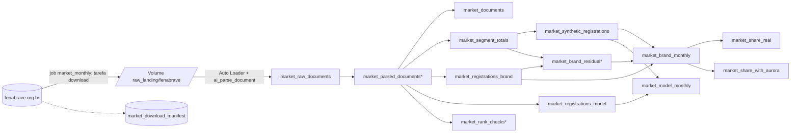

# Modelo de dados: mercado (Tela 1 / Visão de Mercado)

Catálogo e schema: `${catalog}.${schema}` (target `demo` = `classic_stable.auto_intelligence`). Todas as tabelas
têm o prefixo `market_`. As decisões e as alternativas rejeitadas estão no ADR
[`docs/architecture/market-ingestion.md`](../architecture/market-ingestion.md); este documento descreve
**o que existe**, para quem vai consultar os dados (app, Genie Agent, análise).

> **Dado real × sintético.** Os emplacamentos vêm dos PDFs públicos mensais da Fenabrave (todas as marcas).
> A **Aurora Motors é fictícia**: as linhas dela são geradas pelo pipeline, marcadas com `is_synthetic = true`
> e **somadas** ao mercado real, sem tirar volume de nenhuma marca real.

## Linhagem



`*` = tabela interna de apoio, fora do contrato. Pode mudar sem aviso; não use em consumo.

## Qual tabela usar

| Pergunta | Tabela |
|---|---|
| Tamanho do mercado por mês e segmento | `market_segment_totals` |
| Share e ranking de marcas, só mercado real | `market_share_real` |
| Share e ranking de marcas com a Aurora Motors | `market_share_with_aurora` |
| Volume por marca (real, resto não publicado e Aurora) | `market_brand_monthly` |
| Ranking de modelos (top 50 real + modelos Aurora) | `market_model_monthly` |
| Qualidade da ingestão (arquivos, mês resolvido, dialeto) | `market_documents`, `market_download_manifest` |

## Convenções

- `ref_month DATE`: o 1º dia do mês de **referência**, lido do conteúdo do PDF (nunca do nome do arquivo).
- `segment`: `automoveis` ou `comerciais_leves`.
- `share`: **fração** (0,03 = 3%). O denominador é sempre o total publicado na p1 do PDF (mais a Aurora, na
  view com Aurora), nunca a soma das linhas.
- Os rankings publicados são **top N**: marcas = top 20/21; modelos = top 50. O resto do mercado de marcas fica
  numa linha residual `OUTRAS (NAO PUBLICADAS)` (`is_residual = true`), e por isso as marcas somam exatamente
  o total publicado. **Não existe** residual de modelos: a soma dos modelos fica abaixo do total.
- Cada mês usa os números do **próprio** PDF; as revisões que aparecem nos PDFs seguintes são ignoradas.
- `brand` é o nome **como publicado** (maiúsculas, sem acento). Alguns fabricantes têm `/` no nome e são
  marcas distintas. Quando um fabricante muda o nome publicado (por exemplo, em 2023-07), a série dele se
  divide em dois nomes: não existe tabela de aliases (para não haver nomes de marcas no código).
- Cobertura atual: 2003-01 a 2026-09, 285 meses sem lacunas. Em 2004-01 (edição "prévia") só existem os
  totais: o mês não tem ranking de marcas nem de modelos, e o residual é 100%.

## Tabelas

### `market_download_manifest` (tabela Delta, gravada pelo job)
Uma linha por URL candidata testada. PK `source_url`.

| Coluna | Tipo | Descrição |
|---|---|---|
| `source_url` | STRING | URL testada |
| `url_month` | DATE | mês que aparece na URL (rótulo, **não** o mês de referência) |
| `file_path` | STRING | caminho no Volume (nulo se não baixado) |
| `bytes` | BIGINT | tamanho |
| `sha256` | STRING | hash do conteúdo (deduplicação) |
| `status` | STRING | `downloaded`, `duplicate`, `not_found` ou `failed` |
| `duplicate_of` | STRING | URL do arquivo com o mesmo hash |
| `http_status` | INT | último status HTTP |
| `origin` | STRING | `seed` (histórico verificado) ou `discovery` (meses novos) |
| `source_last_modified` | TIMESTAMP | header `Last-Modified` |
| `attempted_at`, `downloaded_at` | TIMESTAMP | última tentativa e primeiro download |

### `market_raw_documents` (bronze, streaming table)
Um PDF por linha, parseado **uma única vez** por `ai_parse_document` (páginas 1, 6 e 8). PK `source_path`.
Colunas: `source_path STRING, file_name STRING, file_size BIGINT, file_modification_time TIMESTAMP,
parsed VARIANT, _ingested_at TIMESTAMP`. Um full refresh está bloqueado (`pipelines.reset.allowed=false`).

### `market_documents` (silver)
Uma linha por PDF, com o mês resolvido. PK `source_path`.
`source_path, file_name, ref_month DATE, month_source STRING ('p6_header'|'p1_header'|'title'),
parse_dialect STRING, parse_status STRING ('ok'|'error'|'no_month'), is_selected BOOLEAN (o arquivo que vale
para o mês), source_last_modified TIMESTAMP (= momento em que o arquivo chegou ao Volume), _ingested_at TIMESTAMP`.

### `market_segment_totals` (silver)
Total publicado por mês e segmento: **o denominador de todo share**. PK (`ref_month`, `segment`).
`ref_month, segment, units INT, brand_table_found BOOLEAN, model_table_found BOOLEAN, source_file STRING,
parse_dialect STRING`.

### `market_registrations_brand` (silver, real)
Ranking de marcas publicado (top 20/21). PK (`ref_month`, `segment`, `brand`).
`ref_month, segment, brand STRING, units INT, rank INT, source_file, page_id INT, parse_dialect`.

### `market_registrations_model` (silver, real)
Ranking de modelos publicado (top 50). PK (`ref_month`, `segment`, `brand`, `model`).
`ref_month, segment, brand, brand_raw STRING (como veio no PDF), brand_matched BOOLEAN (casou com a tabela de
marcas do mês), model STRING, units INT, rank INT, source_file, page_id, parse_dialect`.

### `market_synthetic_registrations` (silver, **sintético**)
Aurora Motors: só automóveis, desde 2019-01, modelos `IPE`, `JATOBA` e `AROEIRA`. PK (`ref_month`, `segment`,
`brand`, `model`).
`ref_month, segment, brand ('AURORA MOTORS'), model, units INT, target_share DOUBLE, is_synthetic BOOLEAN
(sempre true), generator_version STRING, seed INT`.
Volume do mês = `round(share × total_real / (1 − share))`. O share fica entre 0 e 4% de 2019 a 2021 e entre
3% e 4% de 2022 em diante.

### `market_brand_monthly` (gold)
Marcas reais + linha residual + Aurora. PK (`ref_month`, `segment`, `brand`).
`ref_month, segment, brand, units INT, rank INT (posição publicada no PDF; nula no residual e na Aurora),
is_synthetic BOOLEAN, is_residual BOOLEAN`.

### `market_model_monthly` (gold)
Top 50 real + modelos Aurora. PK (`ref_month`, `segment`, `brand`, `model`).
`ref_month, segment, brand, model, units INT, rank INT (publicado; nulo na Aurora), is_synthetic BOOLEAN`.

### `market_share_real` e `market_share_with_aurora` (gold)
As mesmas colunas, PK (`ref_month`, `segment`, `brand`):
`ref_month, segment, brand, units INT, segment_total_units INT, share DOUBLE, rank INT, is_synthetic BOOLEAN,
is_residual BOOLEAN`.
- `market_share_real`: sem linhas sintéticas; `segment_total_units` = total publicado.
- `market_share_with_aurora`: inclui a Aurora; `segment_total_units` = total publicado + Aurora.
- `rank` = `dense_rank()` por `units` decrescente entre as linhas não residuais (a Aurora entra no ranking da
  view com Aurora). O residual aparece nas duas views com `rank` nulo.

## Exemplos

```sql
-- Top 10 marcas de automóveis em 2026-09, com a Aurora Motors
SELECT rank, brand, units, round(100 * share, 2) AS share_pct, is_synthetic
FROM classic_stable.auto_intelligence.market_share_with_aurora
WHERE ref_month = DATE'2026-09-01' AND segment = 'automoveis' AND NOT is_residual
ORDER BY rank LIMIT 10;

-- Série do mercado total de automóveis
SELECT ref_month, units FROM classic_stable.auto_intelligence.market_segment_totals
WHERE segment = 'automoveis' ORDER BY ref_month;
```
